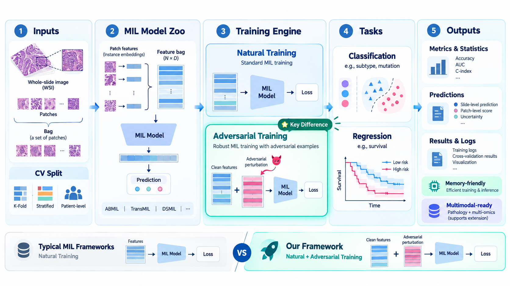

# 支持对抗训练的多实例学习通用训练框架 — V1

[English](README.md) | 简体中文

一个基于 PyTorch、面向病理图像多实例学习（Multiple Instance Learning，MIL）研究的工作站。本工作站的核心特色是**支持 MIL 模型的对抗训练策略**，同时提供自然训练流程。V1 已将针对预提取病理特征的 PGD 对抗训练集成到统一的训练流程中。

## 核心特性

- **统一的 MIL 训练框架：**不同模型共用适配器规范、数据集接口及训练与评估流程。
- **MIL 模型适配：**提供统一适配接口和模型注册机制，本文以门控注意力 ABMIL 为例。
- **自然训练与对抗训练：**支持标准优化，以及针对实例特征的 PGD 对抗训练，并提供干净特征与对抗特征上的评估。
- **任务相关学习：**提供分类训练流程及离散时间生存建模组件。
- **内存友好的数据加载：**按病例加载特征 Bag，支持实例采样，每个 batch 处理一个病例。
- **评估与结果报告：**提供分类指标、生存一致性指数、跨折统计、预测 CSV 和诊断图表。
- **多模态扩展接口：**提供按病例对齐的数据集接口，面向后续病理与组学联合建模研究。

## 框架概览



框架将数据划分与特征加载、自然及对抗训练、MIL 预测和结果评估连接为统一流程，以预提取的病理特征为输入，并提供生存建模组件及面向未来多模态研究的扩展接口。

## MIL 模型示例：ABMIL

本文以门控注意力 ABMIL 演示模型接入与训练，其适配器在 [`utils/load_init_model.py`](utils/load_init_model.py) 中注册：

| `--model_name` | 实现 | 说明 |
| --- | --- | --- |
| `abmil` | 门控注意力 ABMIL | MLP 特征投影、注意力池化和线性预测头。 |

ABMIL 接收形状为 `[1, N, D]` 的实例特征，通过注意力池化生成病例级预测。更多多实例学习模型架构与参考实现，见 [MIL-Lab](https://github.com/mahmoodlab/MIL-Lab)。

## 任务与训练模式

| 任务 | 建模方式 |
| --- | --- |
| 分类 | 整数类别标签、交叉熵损失及二分类/多分类评估，可使用肿瘤亚型、突变状态等病例级标签。 |
| 生存建模组件 | 离散时间 `NLLSurvLoss`、事件与时间属性、基于 hazard 的风险分数及考虑删失的一致性指数。 |

任务 YAML 中的 `task_type` 应与命令行 `--task_type` 保持一致。以下示例统一使用 ABMIL 演示分类任务。

- **自然训练：**不传入 `--adversarial_training`，使用干净特征训练，训练后在干净特征上执行验证和测试。
- **对抗训练：**添加 `--adversarial_training --perturb_config pgd_at --adv_training_types at`。特征扰动采用随机初始化、归一化梯度更新、L2 投影及基于特征激活统计的缩放。训练使用对抗 Bag，训练后执行对抗验证，以及干净和对抗测试。

对于包含多张切片的病例，`--slide_merge_mode list` 分别编码各切片并平均 logits；`concat` 则先拼接实例再编码。

## 运行环境

参考 Conda 环境：

| 组件 | 版本 |
| --- | --- |
| Python | `3.10.14` |
| PyTorch | `2.7.1+cu118`（CUDA 11.8） |

默认使用 **CUDA** 运行。

## 快速开始

### 1. 准备特征 Bag 与任务元数据

前期病理图像的组织分割、裁块及特征表示提取等流程，见 [TRIDENT](https://github.com/mahmoodlab/TRIDENT)。请在框架外完成实例特征提取，再按下表组织 HDF5 特征与元数据。

将每张切片保存为一个 `<slide_id>.h5` 文件，直接放在特征目录中，每个文件需包含：

| HDF5 字段 | 内容 |
| --- | --- |
| `features` | 形状为 `[N, D]` 的实例特征，`D` 必须与 `--input_feature_dim` 一致。 |
| `coords` | 与特征行对应的实例坐标，通常为 `[N, 2]`。 |
| `coords.attrs["patch_size_level0"]` | level 0 下的数值型 patch 尺寸。 |

可参考 `test_task/t1_vs_t2/` 中的分类元数据模板，准备与切片 ID 对应的 HDF5 特征文件。

- **任务 YAML：**定义 `sample_col`、`task_col`、`task_type`、`extra_cols`、`label_dict` 和 `metrics`。分类标签编码为 `0` 至 `C-1` 的整数，并与 `label_dict` 保持一致。
- **划分 TSV：**包含样本列、`slide_id`、目标列、附加属性及连续编号的 `fold_0`、`fold_1` 等列。每折应包含 `train`、`val` 和 `test` 子集，同一病例的标签和折分配需保持一致。

可通过 Python 数据集接口自定义特征变换。

### 2. 自然训练

在项目根目录执行。以下示例使用 Bash 的续行语法，请替换特征路径，并使 `--input_feature_dim` 与实际特征维度一致。

```bash
python main_args.py \
  --mode train --task_type classification --model_name abmil \
  --split test_task/t1_vs_t2/k=all.tsv \
  --task_config test_task/t1_vs_t2/config.yaml \
  --modalities slide --slide_merge_mode list \
  --slide_embeddings_dirs /absolute/path/to/features \
  --input_feature_dim 1024 --embed_dim 512 \
  --batch_size 1 --gradient_accumulation 1 --bag_size None \
  --checkpoint_strategy best-val-loss \
  --results_dir_root ./mil_results/natural
```

该命令使用 ABMIL 完成示例中的全部五折训练，随后重新加载保存的 checkpoint 进行验证和测试。

### 3. 对抗训练

```bash
python main_args.py \
  --mode train --task_type classification --model_name abmil \
  --split test_task/t1_vs_t2/k=all.tsv \
  --task_config test_task/t1_vs_t2/config.yaml \
  --modalities slide --slide_merge_mode list \
  --slide_embeddings_dirs /absolute/path/to/features \
  --input_feature_dim 1024 --embed_dim 512 \
  --batch_size 1 --gradient_accumulation 1 --bag_size None \
  --adversarial_training --perturb_config pgd_at --adv_training_types at \
  --adv_eps 1.0 --adv_alpha 0.2 --adv_steps 5 \
  --checkpoint_strategy best-val-loss \
  --results_dir_root ./mil_results/adversarial
```

单独评估时，沿用对应命令并改为 `--mode test`，保持结果根目录、模型、特征维度和任务配置一致。程序从 `<results_dir_root>/<model_name>/checkpoints/fold_<i>/` 加载权重；存在多个 checkpoint 时选择 epoch 编号最大的文件。

### 4. 可选：重新生成数据划分

如需在训练前生成新的病例级分层划分：

```bash
python get_split_args.py \
  --split test_task/t1_vs_t2/k=all.tsv \
  --task_config test_task/t1_vs_t2/config.yaml \
  --num_folds 5 --cv_type kfold_test --val_frac 0.2 --seed 1
```

工具会在输入文件所在目录生成 `k=all_new.tsv`、`folds_split.png` 和 `labels_split.png`，训练时将新 TSV 传给 `--split`。`kfold_test` 轮换各折测试集，并从剩余病例中划出验证集。

### 关键参数

| 参数 | 默认值或行为 |
| --- | --- |
| `--device`、`--seed` | 分别为 `cuda`、`1`。 |
| `--num_epochs` | 每折训练 `300` 个 epoch。 |
| `--base_learning_rate`、`--weight_decay` | 均为 `1e-5`。 |
| `--optimizer_type`、`--scheduler_type` | 默认为 `AdamW` 和 `cosine`；`--scheduler_type None` 使用固定学习率。 |
| `--bag_size` | `None` 使用全部实例，正整数表示对每个 Bag 采样；验证和测试阶段同样执行采样。 |
| `--batch_size`、`--gradient_accumulation` | 均默认为 `1`；示例中每个 batch 处理一个病例。 |
| `--balanced` | 根据各折训练标签计算类别权重，用于交叉熵损失。 |
| `--checkpoint_strategy` | 支持 `best-val-loss`、`every-K`、`last-K`，如 `every-5` 或 `last-1`，其中 `K` 为正整数。 |
| `--early_stopping` | 可选，仅在 `best-val-loss` 路径中依据验证损失执行；至少训练 10 个 epoch，耐心值为 5。 |
| `--results_dir_root` | 默认为 `./mil_results`，输出位于其 `<model_name>` 子目录；不同实验应使用不同结果根目录。 |
| `--view_progress` | 支持 `bar` 和 `verbose`。 |

## 评估与输出

分类报告包含准确率（`acc`）、平衡准确率（`bacc`）、宏平均 OvR/OvO ROC AUC、宏平均及加权平均的精确率、召回率与 F1、二次加权 Kappa 和样本数（support）。可视化包括 ROC 曲线、标注 PR 面积的精确率–召回率曲线及混淆矩阵。生存分析报告考虑删失的一致性指数（`cindex`）。

多折指标按均值和标准误汇总。

输出保存至 `<results_dir_root>/<model_name>/`：

| 路径 | 内容 |
| --- | --- |
| `experiment.txt`、`model.txt`、`split.csv` | 主要实验设置、模型结构与参数量、实际使用的数据划分。 |
| `progress.txt` | 追加记录折数、epoch 和运行阶段。 |
| `checkpoints/fold_<i>/epoch_<e>.pt` | 模型状态字典。 |
| `loss_metrics/fold_<i>/` | 损失记录 `loss_record.json` 及损失曲线 `loss_curve.png`。 |
| `<setting>_test_probs/fold_<i>.csv` | 病例 ID、标签、预测类别及各类概率；生存任务保存事件、时间和风险分数。 |
| `<setting>_<val-or-test>_metrics/fold_<i>/` | `metrics.json`，以及分类图表 `roc_curves.png`、`pr_curves.png`、`confusion_matrices.png`。 |
| `<setting>_<val-or-test>_metrics_summary.json` | 跨折指标汇总。 |
| `pgd_at_e<eps>_a<alpha>_s<steps>_config.txt` | 对抗模式下的攻击配置。 |

`<setting>` 为 `clean` 或 `adv_e<eps>_a<alpha>_s<steps>`。

## 项目结构

```text
.
├── main_args.py                 # 训练与 checkpoint 评估入口
├── get_split_args.py            # 数据划分及划分可视化
├── datasets/                    # 划分、HDF5 切片 Bag、标签、组学与变换
├── models/
│   ├── slide_only_models/       # MIL 模型实现、基础接口与注意力层
│   └── attack_models/           # 特征空间 PGD
├── losses/                      # 离散时间生存 NLL 与 Cox 损失工具
├── metrics/                     # 分类、生存、统计与绘图
├── utils/
│   ├── core/                   # 自然/对抗训练包装器及共享循环
│   ├── extensions/             # 序列化与模型显示工具
│   ├── prepare_utils.py        # 数据集、损失、模型与优化器准备
│   ├── load_init_model.py      # MIL 模型注册与适配器
│   ├── load_attack_model.py    # 攻击策略注册与适配器
│   ├── get_split_task_utils.py # 任务配置与划分加载
│   └── checkpoint_utils.py     # 权重读写与模型信息保存
├── test_task/                   # 分类与 OS 生存任务元数据示例
├── figs/fig1.png                # 框架图
└── LICENSE.txt                 # MIT 许可证
```

## 扩展能力

- **新增 MIL 模型：**在 `models/slide_only_models/` 实现 MIL 接口，添加 `BaseSlideEncoder` 适配器，并在 `utils/load_init_model.py` 注册，保持 logits 与日志字典的返回约定。
- **新增训练策略：**扩展 `utils/load_attack_model.py` 中的攻击注册机制、对抗训练包装器及共享训练循环，引入新的扰动方式和训练目标。
- **数据接口：**通过数据集 API 自定义特征变换，并组合按病例对齐的切片与组学数据。
- **后续研究方向：**拓展包括连续目标建模在内的任务类型，以及病理与组学多模态融合。

## 版本

**V1**
